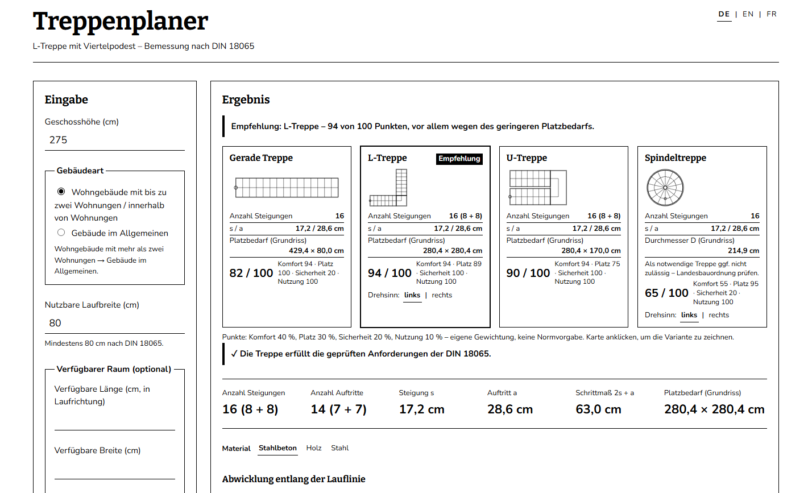

# Treppenplaner

Web-App für Architekturstudierende: Aus Geschosshöhe, Gebäudeart und verfügbarem Raum berechnet der Treppenplaner eine gerade, eine L-, eine U- und eine Spindeltreppe, prüft sie nach DIN 18065 und empfiehlt die passendste. Jede Variante wird als Abwicklung und Grundriss gezeichnet und lässt sich als DXF, SVG oder PDF exportieren.

**Live:** https://jade-hs-vibecoding-wpk.github.io/treppenplaner/



*WPK Vibecoding KI-Werkstatt · Jade Hochschule · November 2026*

## Funktionen

| Funktion | Beschreibung |
|---|---|
| Treppenformen | Gerade Treppe, L-Treppe mit Viertelpodest (links/rechts), U-Treppe mit Halbpodest, Spindeltreppe (links/rechts drehend) |
| Normprüfung DIN 18065 | Steigung, Auftritt, Schrittmaßregel, nutzbare Laufbreite, Stufen je Lauf, Podestlänge; bei der Spindeltreppe zusätzlich Auftritt an der inneren Begrenzung, Lauflinie im Gehbereich und lichte Durchgangshöhe – jede Zeile ✓ oder ✗ |
| Raumprüfung | Passt die Treppe in die verfügbare Länge × Breite? Wenn nicht: Fehlmaß in cm, Überstand im Grundriss schraffiert |
| Variantenvergleich | Vier Karten mit Mini-Grundriss, Punkten und Empfehlung mit Begründungssatz; bei der Spindeltreppe der Hinweis „Als notwendige Treppe ggf. nicht zulässig – Landesbauordnung prüfen.“ |
| Hinweis „sehr steil“ | Bei s ≥ 19 cm oder a ≤ 24 cm (Hinweis, kein Normverstoß) |
| Zeichnungen | Schnitt bzw. Abwicklung entlang der Lauflinie und Grundriss mit Stufennummern, Lauflinie und Maßketten |
| Materialwahl | Stahlbeton (Laufplatte), Holz oder Stahl (Wangentreppe mit offenen Trittstufen): ändert Konstruktion und Schraffur in Schnitt, Grundriss und Export – nicht die Normprüfung. Bei der Spindeltreppe bestimmt das Material Spindeldurchmesser und Stufendicke und geht damit in die Berechnung ein. Maße sind Annahmen, keine Normwerte; Schraffur vereinfacht |
| Export | DXF (Schnitt und Grundriss getrennt), SVG, PDF über den Druckdialog |
| Sprachen | Deutsch, Englisch, Französisch |

## Wie rechnet der Treppenplaner?

1. **Steigungszahl:** Für jede mögliche Anzahl Steigungen n gilt s = Geschosshöhe ÷ n. Der Auftritt folgt aus der Schrittmaßregel **2s + a = 63 cm** (Faustregel; zulässig sind 59–65 cm) und wird auf die Normgrenzen der Gebäudeart begrenzt. Bevorzugt wird die bequemste normgerechte Stufung (nahe 17/29 cm).
2. **Aufteilung auf Läufe:** L- und U-Treppe teilen die Steigungen auf zwei Läufe auf; das Podest ersetzt einen Auftritt. Geprüft werden alle Aufteilungen, gewählt wird die normgerechte, die in den Raum passt und möglichst ausgewogen ist.
3. **Podest-Regeln:** mindestens 3 Steigungen je Lauf; Podestlänge mindestens so groß wie die nutzbare Laufbreite; bei „Gebäude im Allgemeinen“ höchstens 18 Steigungen je Lauf (in Wohngebäuden mit bis zu zwei Wohnungen gilt diese Grenze nicht).
4. **Ausschluss:** Eine Variante, die nicht in den Raum passt oder die Norm nicht erfüllt, wird vor der Bewertung ausgeschlossen. Passt die bequemste Stufung nicht, wird zuerst eine steilere, noch normgerechte versucht.
5. **Bewertung:** Punkte 0–100 je Kriterium, gewichtet: **Komfort 40 %, Platz 30 %, Sicherheit 20 %, Nutzung 10 %.** Diese Gewichtung ist eine eigene Festlegung, **keine Normvorgabe**.
   - Komfort: Abstand von s = 17 cm und a = 29 cm
   - Platz: tatsächlich belegte Fläche (Läufe + Podest)
   - Sicherheit: längste Folge von Steigungen ohne Podest (≤ 8 → 100, ≥ 18 → 0)
   - Nutzung: Podest als Ruhepunkt (nur bei „Gebäude im Allgemeinen“)
6. **Empfehlung:** die Variante mit der höchsten Punktzahl. Ist keine geeignet, zeigt das Tool „Keine Variante passt“ und die Variante, der am wenigsten fehlt.

**Spindeltreppe** (Werte zitiert nach Baunetz Wissen, siehe Quellen):

- Steigung und Auftritt wie oben, gemessen auf der Lauflinie.
- **Teilung** t (Stufen je Umdrehung, ganzzahlig): die kleinste, bei der die **lichte Durchgangshöhe** t · s − Stufendicke ≥ 200 cm ist und die Lauflinie in den **Gehbereich** passt.
- **Gehbereich:** 2/10 der nutzbaren Laufbreite, innere Grenze in der Mitte der Laufbreite (gilt bis 130 cm Laufbreite – breitere Spindeltreppen werden ausgeschlossen). Die Lauflinie liegt bevorzugt bei 0,6 · Laufbreite von innen (Empfehlung DGUV-Information BGI/GUV-I 561, zitiert nach Baunetz Wissen), sonst weiter innen im Gehbereich.
- **Mindestauftritt innen:** An der inneren Begrenzung der nutzbaren Laufbreite muss der Auftritt mindestens 10 cm sein; daraus folgt der innere Radius.
- **Durchmesser D** = 2 · (innerer Radius + Laufbreite + Geländerzuschlag). Raumprüfung mit dem Quadrat D × D, Platz-Punkte mit der Kreisfläche.
- Bewertung: Komfort mit den Auftrittspunkten gemittelt über die ganze nutzbare Laufbreite (keilförmige Stufen); Nutzung ohne gerade Läufe und Podest.

## So benutzt du das Tool

1. **Werte eingeben:** Geschosshöhe, Gebäudeart, nutzbare Laufbreite und optional den verfügbaren Raum (Länge × Breite). Dann **Berechnen**.
2. **Karten vergleichen:** Empfehlung, Punkte und Ausschlussgründe der drei Varianten lesen.
3. **Variante anklicken:** Kennwerte, Zeichnungen und Normprüfung wechseln zur gewählten Variante (bei L- und Spindeltreppe Drehsinn links/rechts wählbar).
4. **Material wählen:** Über den Zeichnungen Stahlbeton, Holz oder Stahl – die Zeichnungen wechseln sofort.
5. **Exportieren:** DXF oder SVG für Schnitt und Grundriss, PDF über „Drucken“.

**DXF-Import:** Einheit **mm**, Maßstab **1:1**. Die Beschriftung ist für 1:50 bemessen. Bei Holz und Stahl zusätzliche Ebenen WANGE, TRITTSTUFE und SCHRAFFUR_HOLZ bzw. SCHRAFFUR_STAHL. Bei der Spindeltreppe zusätzlich SPINDEL und GELAENDER (Bögen als ARC bzw. CIRCLE). In AutoCAD 2027 getestet (Ebenen, Maße, Texte, Schraffur, Höhenkoten); ArchiCAD und Revit noch nicht getestet.

## Datenschutz

Der Treppenplaner läuft vollständig im Browser. Es gibt keinen Server, keine Anmeldung, keine API-Schlüssel und keine Daten, die nach außen gesendet werden. Auch die Schriften liegen lokal im Projekt. Gespeichert wird nur die Sprachwahl (`localStorage` im eigenen Browser).

## Technik

Reines HTML, CSS und JavaScript, ohne Frameworks, ohne Build-Schritt und ohne Installation. Veröffentlicht über GitHub Pages.

| Datei | Aufgabe |
|---|---|
| `js/norm.js` | Alle Grenzwerte der DIN 18065 an einer Stelle, jeder Wert mit Quelle. |
| `js/berechnung.js` | Steigung, Auftritt und Schrittmaß für eine Stufenzahl; Wahl der besten Stufung. |
| `js/treppenformen.js` | Aufteilung der Steigungen auf Läufe und Podest (gerade, L, U) und Normprüfung je Form. |
| `js/spindeltreppe.js` | Spindeltreppe: Teilung, Radien, Durchmesser und die zusätzlichen Normprüfungen. |
| `js/raum.js` | Prüft, ob ein rechteckiger Platzbedarf in den verfügbaren Raum passt, und berechnet das Fehlmaß. |
| `js/bewertung.js` | Variantenvergleich: Ausschluss, Punkte, Gewichte, Empfehlung und Hinweis „sehr steil“. |
| `js/variantenkarten.js` | Zeigt Empfehlung, die drei Karten mit Mini-Grundriss und die Kurztabelle für den Druck. |
| `js/elemente.js` | Gemeinsame Geometrieliste (Linie, Fläche, Text …) für Bildschirm und Export. |
| `js/material.js` | Materialien (Stahlbeton, Holz, Stahl): Konstruktion, Bauteilmaße als Annahmen und Schraffur an einer Stelle. |
| `js/zeichnung.js` | Schnitt der geraden Treppe bzw. Abwicklung entlang der Lauflinie. |
| `js/grundriss.js` | Grundriss mit Läufen, Podest, Stufennummern, Lauflinie, Raum und Maßketten. |
| `js/spindelgrundriss.js` | Grundriss der Spindeltreppe (Bögen, radiale Stufen, Austritt, Maße). |
| `js/svg-ausgabe.js` | Gibt eine Geometrieliste als SVG aus. |
| `js/dxf.js` | Schreibt eine Geometrieliste als DXF R12 (mm, Ebenen, Windows-1252). |
| `js/export.js` | Download von DXF und SVG, Drucken als PDF. |
| `js/i18n.js` | Alle Texte auf Deutsch, Englisch und Französisch; Zahlenformat je Sprache. |
| `js/app.js` | Verbindet Formular, Berechnung, Vergleich und Anzeige. |

**Lokal testen:** Im Projektordner einen einfachen Webserver starten, z. B.

```bash
python -m http.server 8000
```

und dann http://localhost:8000 im Browser öffnen.

## Quellen und Lizenzen

- **DIN 18065:2020-08** „Gebäudetreppen“, Tabelle 1 (Steigung, Auftritt, nutzbare Laufbreite) – zitiert nach [WEKA-Fachportal](https://www.weka.de/architekten-ingenieure/din-18065/), **Original nicht eingesehen**.
- **Schrittmaßregel 59–65 cm** nach DIN 18065 – zitiert nach Baunetz Wissen „Spindeltreppen“, **Original nicht eingesehen**.
- **Baunetz Wissen** (mit Verweis auf DIN 18065, Original der Norm nicht eingesehen): mindestens 3 Steigungen je Lauf, Podest spätestens nach 18 Steigungen, Podestlänge ≥ Laufbreite.
  - [Podest](https://www.baunetzwissen.de/glossar/p/podest-3468141)
  - [Treppenlauf](https://www.baunetzwissen.de/treppen/fachwissen/treppenelemente/treppenlauf-3354185)
- **Spindeltreppe** – zitiert nach Baunetz Wissen (mit Verweis auf DIN 18065, Ausgabe nicht genannt), **Original nicht eingesehen**: Lauflinie und Schrittmaß wie bei geraden Treppen (59–65 cm), Gehbereich 2/10 der Laufbreite, Auftritt innen ≥ 10 cm, lichte Durchgangshöhe ≥ 200 cm.
  - [Spindeltreppen](https://www.baunetzwissen.de/treppen/fachwissen/treppenformen/spindeltreppen-3375193)
  - [Gehbereich](https://www.baunetzwissen.de/glossar/g/gehbereich-48139)
- **DGUV Information 208-005** „Treppen“, Kap. 4 (Spindeltreppen nicht im ersten Fluchtweg) – [BGN](https://vorschriften.bgn-branchenwissen.de/daten/dguv/208_005/4.htm), **Original nicht eingesehen**. Ob eine Spindeltreppe als notwendige Treppe zulässig ist, regelt die jeweilige Landesbauordnung – dazu wurde keine eindeutige Quelle gefunden.
- **Schriften:** Bitter und Nunito, SIL Open Font License 1.1, lokal in `fonts/` (`OFL-Bitter.txt`, `OFL-Nunito.txt`).
- **Code:** MIT-Lizenz (siehe `LICENSE`).

**Eigene Annahmen (keine Normwerte):** Laufplatte 18 cm, Geschossdecke 20 cm, Treppenauge der U-Treppe 10 cm, Grenzen für „sehr steil“ (s ≥ 19 cm oder a ≤ 24 cm), Zielwerte 17/29 cm und die Gewichtung der Bewertung. Platzbedarf vereinfacht: Laufbreite = nutzbare Laufbreite, ohne Wangen, Wandabstand sowie Antritts- und Austrittsfläche.

**Eigene Annahmen Spindeltreppe:** Spindeldurchmesser Stahlbeton 20 cm, Holz 12 cm, Stahl 10 cm; Geländerzuschlag außen 5 cm; Stufendicke Holz 5 cm und Stahl 4 cm (wie die Trittstufen), Stahlbeton 8 cm als Kragstufe – **vereinfacht**, Stahlbeton-Spindeltreppen sind meist eine monolithische Wendelplatte; Deckenöffnung als Kreis mit Durchmesser D, die Kopfhöhe an der Deckenkante wird nicht geprüft; Auftritt als Sehne zwischen zwei Stufenvorderkanten gemessen (etwas kleiner als der Bogen, sichere Seite – Messregel der Norm nicht geprüft); Komfort-Bewertung über die ganze Laufbreite gemittelt.

> **Hinweis:** Der Treppenplaner ist eine Orientierungshilfe für Entwurf und Studium. Er ersetzt keine Prüfung nach der jeweiligen Landesbauordnung und keine Fachplanung.

## Einsatz von KI

- **Code:** mit Claude Code (Claude Opus 5.5).
- **Planung und Normrecherche:** mit Claude (Chat).
- **Zeitraum:** 16.–20.11.2026.

**Wer hat was entschieden?**

- **Von mir:** die Idee, die Gestaltungsentscheidungen (Swiss-Stil, Rot nur für Probleme, Layout, Schriften), die Gewichtung der Bewertung (von der KI vorgeschlagen, von mir geprüft und übernommen) sowie das Prüfen der Normwerte und der Ergebnisse von Hand – dabei habe ich u. a. einen Rundungsfehler gefunden.
- **Von mir (Spindeltreppe, 18.11.):** Komfort über die ganze Laufbreite gemittelt (Variante C); Spindeltreppen mit mehr als 130 cm Laufbreite werden ausgeschlossen; bei Raum 230 × 230 cm liegt die steile L-Treppe knapp vor der Spindeltreppe (48 : 46) – bewusst so gelassen, keine neue Punkteregel; der Hinweis zur notwendigen Treppe erscheint bei beiden Gebäudearten; Material geht bei der Spindeltreppe in die Berechnung ein.
- **Von der KI:** die Programmierung und Vorschläge zu Umsetzung, Darstellung und Struktur.

Der Arbeitsprozess ist nachvollziehbar in [`PLAN.md`](PLAN.md) (Plan und Stand), [`CLAUDE.md`](CLAUDE.md) (Regeln für die KI) und [`notlar.md`](notlar.md) (Entscheidungen, Recherche, auf Türkisch).

## Ausblick

- Vertikalschnitt durch die Spindelachse (zusätzlich zur Abwicklung)
- Kopfhöhe / lichte Durchgangshöhe (2,00 m) an der Deckenkante prüfen und darstellen (bei der Spindeltreppe zwischen den Umdrehungen bereits geprüft)
- Maßstabsfigur (menschliche Silhouette) in Schnitt und Grundriss
- Maßstäbliches Drucken (A4 quer, 1:50)
- Gewendelte Stufen statt Podest
- Treppenauge abhängig vom Material (bei Holzwangen wären ≥ 12 cm nötig, bisher fest 10 cm)
- Prüfung offener Stufen (Holz/Stahl) ergänzen
- IFC-/3D-Export
- Gewichtung der Kriterien durch den Nutzer

## Autor und Lizenz

**Osman Atıf Yıldız** · Lizenz: [MIT](LICENSE)
